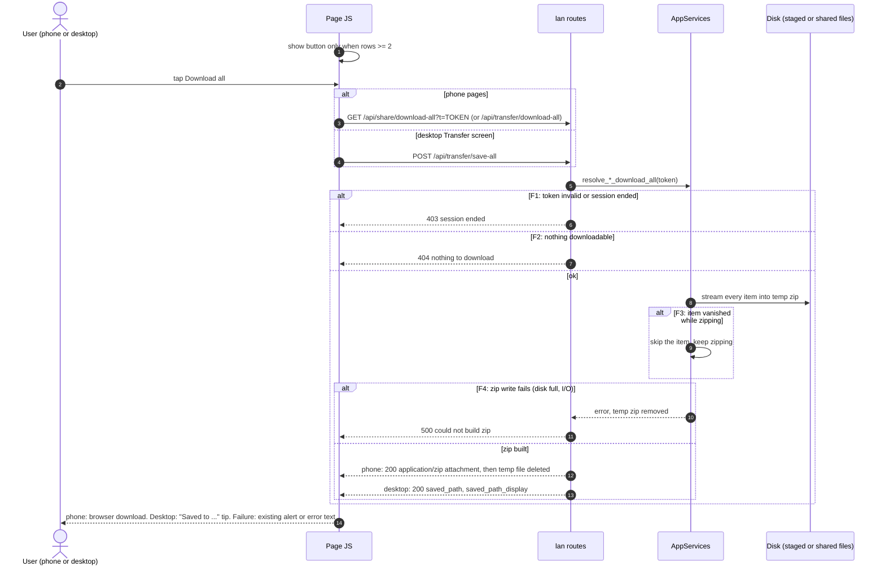
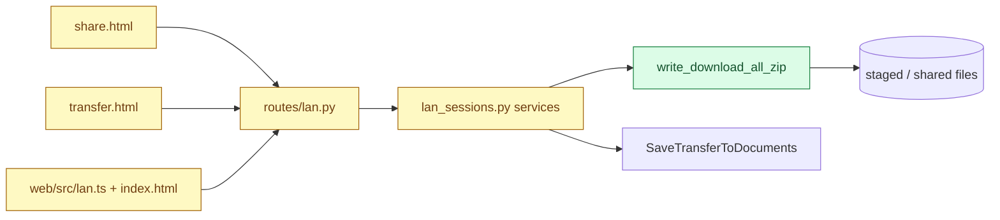

# Download all — system design

- **Wireframes:** [phone-share.html](../../wireframes/phone-share.html), [phone-transfer.html](../../wireframes/phone-transfer.html), [app.html](../../wireframes/app.html) (Transfer files screen)
- **Spec:** `specs/download-all/SPEC.md`, written after this design is approved
- **Design approved:** 2026-10-29 (chat)

## Summary

Every page that lists a few downloadable files gets one **Download all** button that delivers the whole list as a single `.zip`: the phone *Send files* page (`/share`), the phone *Transfer files* page (`/transfer`) and the desktop *Transfer files* screen. The Gallery is out of scope (it has its own batch download). The zip is built on demand from the current session contents, streamed from a temp file and deleted afterwards, exactly like today's folder zips.

## Main flow



## Components



No new port: the zip writer is a pure application function beside `write_folder_zip` in `file_share_manifest.py`; the desktop save reuses the existing documents-save path.

## Data model

None. No new persisted state; the zip is a temp file removed after the response (phone) or moved into `Documents/SpaceMaker` (desktop).

**Migration**

- **Backward compatible:** yes, purely additive endpoints and UI.
- **Order:** backend routes first, then pages.
- **Backfill:** none.
- **Rollback:** remove the button and routes; no data to clean.

## Contracts

```http
GET /api/share/download-all?t=<token>
GET /api/transfer/download-all?t=<token>
```

```http
HTTP/1.1 200 OK
Content-Type: application/zip
Content-Disposition: attachment; filename="SpaceMaker-share.zip"
```

```http
POST /api/transfer/save-all        (desktop, loopback only, like /api/transfer/save)

HTTP/1.1 200 OK
{"saved_path": "/home/u/Documents/SpaceMaker/SpaceMaker-transfer.zip", "saved_name": "SpaceMaker-transfer.zip", "saved_path_display": "~/Documents/SpaceMaker/SpaceMaker-transfer.zip"}
```

| Status | When | Client does |
|--------|------|-------------|
| 403 | token invalid or session ended (F1) | phone: the page's existing "ended" panel. Desktop: alert |
| 404 | session has no downloadable items (F2) | alert "Nothing to download" |
| 500 | zip could not be written (F4) | alert "Could not build the zip" |

- **Entry naming inside the zip:** the row's display name; folder rows keep their folder as a directory (contents under `<folder>/…`); transfer folder items (already a staged `.zip`) are stored as that `.zip`; duplicate names get ` (2)`, ` (3)`, … so nothing is overwritten.
- **Zip filename:** `SpaceMaker-share.zip` (Send files) and `SpaceMaker-transfer.zip` (Transfer files); desktop save uses the existing no-overwrite naming.
- **Versioning:** additive, no existing endpoint changes.
- **Idempotency:** GET is safe to repeat; desktop POST creates a new non-overwriting file each time, like single Download.

## Contract seam

| Wireframe state | Call | Response |
|-----------------|------|----------|
| Phone Send: list with 2+ rows, "Download all (.zip)" | `GET /api/share/download-all` | 200 zip |
| Phone Send: one row, no button | none | n/a (hidden by row count) |
| Phone Transfer: "Download all (.zip)" | `GET /api/transfer/download-all` | 200 zip |
| Desktop Transfer: "Download all" then "Saved to …" tip | `POST /api/transfer/save-all` | 200 `saved_path…` |
| Link expired / session ended panels | same GETs | 403 |

## Open questions

1. **Threshold.** Show the button from **2 items** up (proposed). Alternative: always show it, even for one file.
2. **Compression.** Proposed **stored (no compression)**: fast, low CPU on the PC, and sessions are mostly photos/video/PDF. Alternative: deflate like today's folder zips.
3. **Size limit.** Proposed none beyond free disk in temp (same as folder zips today); the zip is streamed from disk, never held in memory. Alternative: cap and show an error.
4. **Desktop destination.** Proposed: same as single Download (`Documents/SpaceMaker`, with the existing tip). Alternative: a Save-as dialog.
5. **Other pages.** I found only these three with a downloadable file list (USB, Receive and Gallery have none or are excluded). Tell me if there is another page you had in mind.
